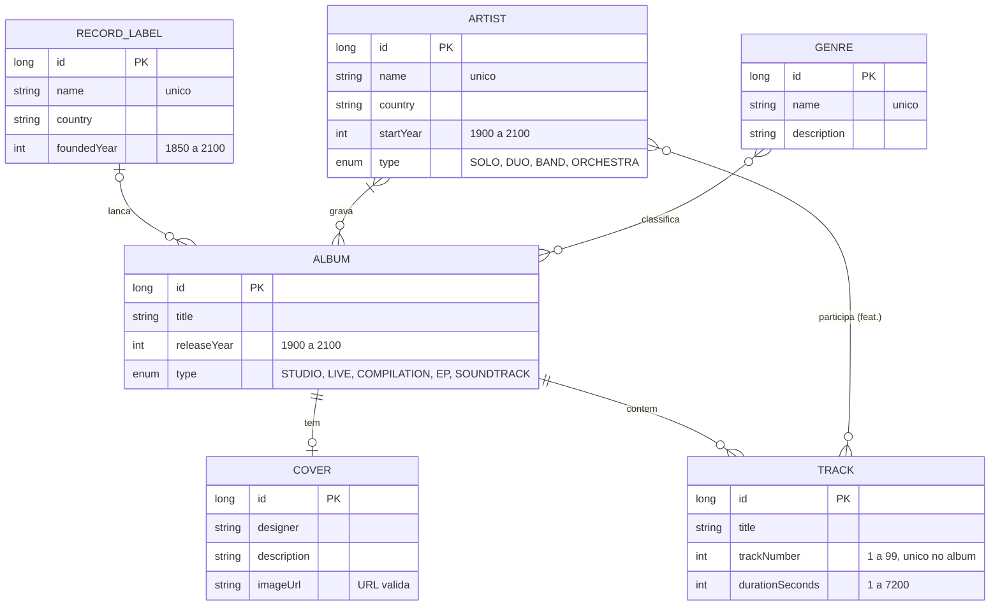

# Music Catalog API

API RESTful para gerenciar um catálogo de discos: artistas, álbuns, faixas, capas, gêneros e gravadoras. Feita com Spring Boot, com respostas em HATEOAS (HAL) e documentação interativa no Swagger.


[](LICENSE)

- **CRUD completo** de 6 recursos, com listagens paginadas e ordenáveis
- **Relacionamentos reais:** álbuns com vários artistas, participações especiais (feat.) em faixas, uma capa por álbum
- **Consultas prontas:** discografia de um artista, álbuns por período, tracklist de um álbum e outras
- **Erros que explicam o motivo:** toda resposta 400, 404 e 409 diz qual campo ou parâmetro falhou e por quê
- **Versionada na URL** (`/v1`), para uma versão nova sair sem tirar a anterior do ar

## Teste no ar

A API está publicada no Render:

| O quê | Endereço |
|---|---|
| **Swagger (documentação e testes)** | **https://api-spring-boot-emzp.onrender.com/swagger-ui.html** |
| Raiz da API, com links para tudo | https://api-spring-boot-emzp.onrender.com/ |
| Exemplo de listagem | https://api-spring-boot-emzp.onrender.com/v1/artists |

No Swagger, abra um endpoint, clique em **Try it out** e depois em **Execute**. O seletor **Select a definition**, no topo, troca a versão exibida.

> Se a API ficar um tempo sem uso, o Render pode desligá-la. A primeira requisição depois disso demora um pouco mais, enquanto ela liga de novo.

## Como rodar no seu computador

Você só precisa do **Java 21**. O Maven já vem no projeto (`mvnw`).

```bash
git clone https://github.com/GiovannaL1ma/API_Spring-Boot.git
cd API_Spring-Boot/api_restful_java-main
./mvnw spring-boot:run          # no Windows (cmd/PowerShell): mvnw.cmd spring-boot:run
```

Com a API no ar:

| O quê | Endereço |
|---|---|
| Swagger (documentação e testes) | http://localhost:8080/swagger-ui.html |
| Raiz da API, com links para tudo | http://localhost:8080/ |
| Console do banco H2 | http://localhost:8080/h2-console (JDBC URL `jdbc:h2:mem:musicdb`, usuário `sa`, senha vazia) |

> O banco fica **em memória**: começa vazio e é apagado sempre que a aplicação reinicia.

### Com Docker

```bash
cd api_restful_java-main
docker build -t music-catalog-api .
docker run -p 8080:8080 music-catalog-api
```

## Primeiros passos

Como um álbum aponta para artistas, gêneros e gravadora pelo `id`, crie nessa ordem: **gravadora → artista → gênero → álbum → faixas e capa**.

O jeito mais fácil é pelo Swagger. Pelo terminal (Git Bash, Linux ou macOS):

```bash
API=http://localhost:8080/v1

curl -X POST $API/labels  -H "Content-Type: application/json" -d '{"name": "Parlophone", "country": "United Kingdom", "foundedYear": 1896}'
curl -X POST $API/artists -H "Content-Type: application/json" -d '{"name": "The Beatles", "country": "United Kingdom", "startYear": 1960, "type": "BAND"}'
curl -X POST $API/genres  -H "Content-Type: application/json" -d '{"name": "Rock"}'
curl -X POST $API/albums  -H "Content-Type: application/json" -d '{"title": "Revolver", "releaseYear": 1966, "type": "STUDIO", "label": {"id": 1}, "artists": [{"id": 1}], "genres": [{"id": 1}]}'
curl -X POST $API/tracks  -H "Content-Type: application/json" -d '{"title": "Taxman", "trackNumber": 1, "durationSeconds": 159, "album": {"id": 1}}'
curl -X POST $API/covers  -H "Content-Type: application/json" -d '{"designer": "Klaus Voormann", "imageUrl": "https://example.com/covers/revolver.jpg", "album": {"id": 1}}'

curl $API/tracks/album/1                     # tracklist do álbum
curl "$API/albums/released?from=1960&to=1969" # álbuns lançados nos anos 60
```

> No PowerShell, `curl` é outro comando. Use o Git Bash ou o Swagger.

Cada resposta traz o recurso e os links para navegar até os relacionados. Exemplo de `GET /v1/artists/1`:

```json
{
  "name": "The Beatles",
  "country": "United Kingdom",
  "startYear": 1960,
  "type": "BAND",
  "id": 1,
  "_links": {
    "self":       { "href": "http://localhost:8080/v1/artists/1" },
    "update":     { "href": "http://localhost:8080/v1/artists/1" },
    "delete":     { "href": "http://localhost:8080/v1/artists/1" },
    "albums":     { "href": "http://localhost:8080/v1/albums/artist/1" },
    "featuredOn": { "href": "http://localhost:8080/v1/tracks/featuring/1" },
    "artists":    { "href": "http://localhost:8080/v1/artists" }
  }
}
```

## Endpoints

Todas as rotas começam com `/v1`. As listagens aceitam `?page=0&size=10&sort=campo,asc` (ou `desc`).

<details>
<summary><strong>Artistas</strong> <code>/v1/artists</code></summary>

| Método | Rota | O que faz |
|---|---|---|
| GET | `/v1/artists` | Lista paginada |
| GET | `/v1/artists/{id}` | Busca por id |
| POST | `/v1/artists` | Cria um artista (`name` é único) |
| PUT | `/v1/artists/{id}` | Substitui todos os dados |
| DELETE | `/v1/artists/{id}` | Exclui (só artistas sem álbuns) |
| GET | `/v1/artists/search?name=` | Busca por parte do nome |
| GET | `/v1/artists/type/{type}` | Filtra por `SOLO`, `DUO`, `BAND` ou `ORCHESTRA` |
| GET | `/v1/artists/genre/{genreId}` | Artistas que lançaram álbuns do gênero |

</details>

<details>
<summary><strong>Álbuns</strong> <code>/v1/albums</code></summary>

| Método | Rota | O que faz |
|---|---|---|
| GET | `/v1/albums` | Lista paginada |
| GET | `/v1/albums/{id}` | Busca por id |
| POST | `/v1/albums` | Cria um álbum (artistas, gêneros e gravadora pelo id; ao menos um artista) |
| PUT | `/v1/albums/{id}` | Substitui todos os dados |
| DELETE | `/v1/albums/{id}` | Exclui junto com as faixas e a capa |
| GET | `/v1/albums/search?title=` | Busca por parte do título |
| GET | `/v1/albums/type/{type}` | Filtra por `STUDIO`, `LIVE`, `COMPILATION`, `EP` ou `SOUNDTRACK` |
| GET | `/v1/albums/released?from=&to=` | Lançados entre dois anos |
| GET | `/v1/albums/artist/{artistId}` | Discografia de um artista |
| GET | `/v1/albums/genre/{genreId}` | Álbuns de um gênero |
| GET | `/v1/albums/label/{labelId}` | Catálogo de uma gravadora |

</details>

<details>
<summary><strong>Faixas</strong> <code>/v1/tracks</code></summary>

| Método | Rota | O que faz |
|---|---|---|
| GET | `/v1/tracks` | Lista paginada |
| GET | `/v1/tracks/{id}` | Busca por id |
| POST | `/v1/tracks` | Cria uma faixa (`trackNumber` é único dentro do álbum) |
| PUT | `/v1/tracks/{id}` | Substitui todos os dados |
| DELETE | `/v1/tracks/{id}` | Exclui a faixa |
| GET | `/v1/tracks/search?title=` | Busca por parte do título |
| GET | `/v1/tracks/album/{albumId}` | Tracklist de um álbum, na ordem do disco |
| GET | `/v1/tracks/featuring/{artistId}` | Participações especiais de um artista |

</details>

<details>
<summary><strong>Capas</strong> <code>/v1/covers</code></summary>

| Método | Rota | O que faz |
|---|---|---|
| GET | `/v1/covers` | Lista paginada |
| GET | `/v1/covers/{id}` | Busca por id |
| POST | `/v1/covers` | Cria a capa de um álbum (uma por álbum) |
| PUT | `/v1/covers/{id}` | Substitui todos os dados |
| DELETE | `/v1/covers/{id}` | Exclui a capa; o álbum continua |
| GET | `/v1/covers/search?designer=` | Busca por parte do nome do designer |
| GET | `/v1/covers/album/{albumId}` | Capa de um álbum |

</details>

<details>
<summary><strong>Gêneros</strong> <code>/v1/genres</code></summary>

| Método | Rota | O que faz |
|---|---|---|
| GET | `/v1/genres` | Lista paginada |
| GET | `/v1/genres/{id}` | Busca por id |
| POST | `/v1/genres` | Cria um gênero (`name` é único) |
| PUT | `/v1/genres/{id}` | Substitui todos os dados |
| DELETE | `/v1/genres/{id}` | Exclui e tira o gênero dos álbuns |
| GET | `/v1/genres/search?name=` | Busca por parte do nome |

</details>

<details>
<summary><strong>Gravadoras</strong> <code>/v1/labels</code></summary>

| Método | Rota | O que faz |
|---|---|---|
| GET | `/v1/labels` | Lista paginada |
| GET | `/v1/labels/{id}` | Busca por id |
| POST | `/v1/labels` | Cria uma gravadora (`name` é único) |
| PUT | `/v1/labels/{id}` | Substitui todos os dados |
| DELETE | `/v1/labels/{id}` | Exclui (só gravadoras sem álbuns) |
| GET | `/v1/labels/search?country=` ou `?name=` | Busca por país ou por parte do nome |

</details>

Os campos, os limites de cada um e os exemplos de JSON estão no Swagger.

## Modelo de dados



## Erros

Toda resposta de erro diz o motivo:

| Status | Quando acontece | Exemplo de resposta |
|---|---|---|
| **400** | Campo inválido, tipo errado no JSON, id que não é número, parâmetro faltando ou `sort` com campo inexistente | `Invalid value 'abc' for parameter 'id': it must be a whole number` |
| **404** | O registro não existe | `Could not find artist with ID: 99` |
| **409** | Valor único repetido, ou exclusão de um registro que ainda está em uso | `Artist with ID: 1 still has albums; remove the artist from them or delete them first` |

Quando a validação do JSON falha, a resposta lista cada campo com o problema dele:

```json
{ "name": "tamanho deve ser entre 1 e 100", "startYear": "deve ser maior que ou igual à 1900" }
```

## Versionamento

- **A versão principal fica na URL** (`/v1`). Uma mudança que quebra quem já usa a API sai como `/v2`, e a `/v1` continua no ar.
- **O número completo** segue o [Versionamento Semântico](https://semver.org/lang/pt-BR/) (`MAJOR.MINOR.PATCH`) e aparece no Swagger e na raiz (`/`).
- **O histórico de cada versão** está no [CHANGELOG.md](CHANGELOG.md).

Para lançar uma versão nova:

1. Atualize o `<version>` do `pom.xml` e a constante de versão em `OpenApi.java`.
2. Registre o que mudou no `CHANGELOG.md`.
3. Faça o commit, crie a tag e envie as duas coisas:

   ```bash
   git tag -a v1.0.1 -m "Versao 1.0.1"
   git push origin main
   git push origin v1.0.1
   ```

## Tecnologias

- Java 21 e Spring Boot 4.1.1 (Web MVC, Data JPA, Validation, HATEOAS)
- H2 (banco em memória)
- springdoc-openapi 3.1.1 (Swagger UI)
- Maven Wrapper e Docker, com deploy no Render

## Estrutura do projeto

```
.
├── api_restful_java-main/              # projeto Spring Boot
│   ├── Dockerfile                      # imagem usada no deploy
│   ├── pom.xml
│   └── src/main/
│       ├── java/com/senac/tsi/MusicApi/
│       │   ├── Album.java, Artist.java...  # entidades (viram tabelas no banco)
│       │   ├── *Controller.java            # endpoints REST (/v1/...)
│       │   ├── *ModelAssembler.java        # links HATEOAS de cada recurso
│       │   ├── *Repository.java            # consultas ao banco (Spring Data JPA)
│       │   ├── ApiExceptionAdvice.java     # transforma exceções em respostas 400, 404 e 409
│       │   ├── JacksonConfig.java          # leitura estrita do JSON (tipo certo em cada campo)
│       │   └── OpenApi.java                # cabeçalho do Swagger e versões
│       └── resources/
│           ├── application.properties
│           └── static/                     # termos de serviço e licença servidos pela API
├── CHANGELOG.md
└── LICENSE
```

## Licença e termos

- **Código:** [Licença MIT](LICENSE).
- **Uso da API publicada:** [termos de serviço](https://api-spring-boot-emzp.onrender.com/terms.html). Resumindo: a API é pública, não tem login, guarda os dados só em memória e não deve receber dados pessoais.

## Autoria

Desenvolvido por **Giovanna Lima** no curso de TSI do Senac São Paulo.
