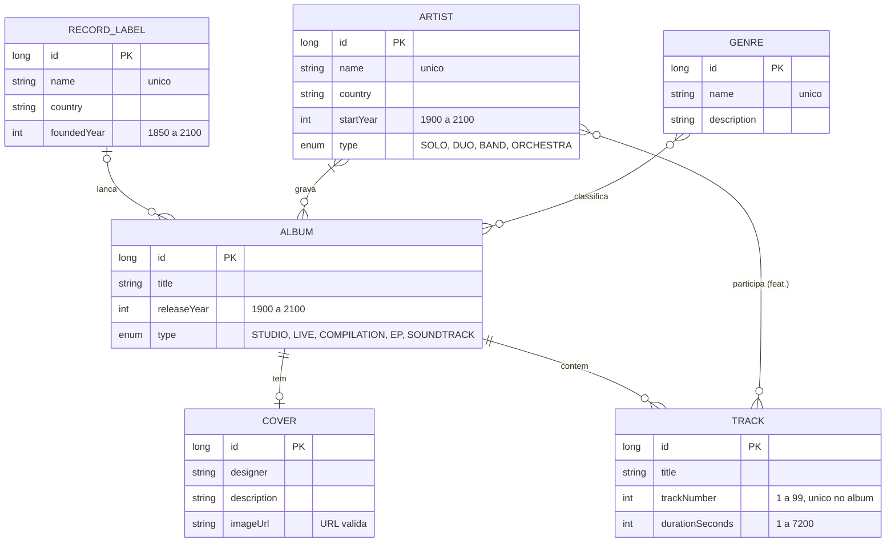

# Music Catalog API

API RESTful para gerenciar um catálogo de discos: artistas, álbuns, faixas, capas, gêneros e gravadoras. Feita com Spring Boot, com respostas em HATEOAS (HAL) e documentação interativa no Swagger.


[](LICENSE)

- **CRUD completo** de 6 recursos, com listagens paginadas e ordenáveis
- **Relacionamentos reais:** álbuns com vários artistas, participações especiais (feat.) em faixas, uma capa por álbum
- **Chave de API** (`X-API-Key`) com dois níveis de acesso: leitura livre, escrita com chave, gestão das chaves só para ADMIN
- **Idempotência** (`X-Idempotency-Key`): repetir um POST não cria registro duplicado
- **Limite de requisições** por cliente, com os cabeçalhos `X-RateLimit-*` e `429` + `Retry-After`
- **Duas versões** dos endpoints de faixas, escolhidas pelo header `X-API-Version`
- **CORS** liberado só para as origens configuradas
- **Erros que explicam o motivo:** toda resposta de erro diz qual campo, parâmetro ou header falhou e por quê

## Teste no ar

A API está publicada no Render:

| O quê | Endereço |
|---|---|
| **Swagger (documentação e testes)** | **https://api-spring-boot-emzp.onrender.com/swagger-ui.html** |
| Raiz da API, com links para tudo | https://api-spring-boot-emzp.onrender.com/ |
| Exemplo de listagem | https://api-spring-boot-emzp.onrender.com/artists |

Para testar no Swagger:

1. Em **API Keys → POST /api-keys**, clique em **Try it out** e **Execute**. Copie o valor do campo `apiKey` da resposta.
2. Clique em **Authorize** (no topo), cole a chave e confirme. A partir daí o Swagger manda a chave em toda requisição.
3. Abra qualquer endpoint, **Try it out** e **Execute**. O seletor **Select a definition** troca entre a versão 1 e a 2.

> Se a API ficar um tempo sem uso, o Render pode desligá-la. A primeira requisição depois disso demora um pouco mais, enquanto ela liga de novo.

## Como rodar no seu computador

Você só precisa do **Java 21**. O Maven já vem no projeto (`mvnw`).

```bash
git clone https://github.com/GiovannaL1ma/API_Spring-Boot.git
cd API_Spring-Boot/api_restful_java-main
./mvnw spring-boot:run          # no Windows (cmd/PowerShell): mvnw.cmd spring-boot:run
```

Com a API no ar:

| O quê | Endereço |
|---|---|
| Swagger (documentação e testes) | http://localhost:8080/swagger-ui.html |
| Raiz da API, com links para tudo | http://localhost:8080/ |
| Console do banco H2 | http://localhost:8080/h2-console (JDBC URL `jdbc:h2:mem:musicdb`, usuário `sa`, senha vazia) |

> O banco fica **em memória**: começa vazio e é apagado sempre que a aplicação reinicia (inclusive as chaves de API).

**Chave ADMIN:** sem configuração nenhuma, a API gera uma chave ADMIN nova a cada execução e mostra no log, numa linha como `Chave ADMIN gerada para esta execucao: mca_...`. Para fixar uma chave, defina a variável de ambiente `API_ADMIN_KEY` antes de rodar (no Render: *Environment → Add Environment Variable*).

### Com Docker

```bash
cd api_restful_java-main
docker build -t music-catalog-api .
docker run -p 8080:8080 -e API_ADMIN_KEY=minha-chave-admin music-catalog-api
```

### Testes automatizados

```bash
./mvnw test
```

Os testes sobem a API inteira e conferem a chave de API, a idempotência, as duas versões das faixas, o CORS e o limite de requisições.

## Primeiros passos

Ler é livre, mas criar, alterar e excluir pede uma chave. Como um álbum aponta para artistas, gêneros e gravadora pelo `id`, crie nessa ordem: **gravadora → artista → gênero → álbum → faixas e capa**.

Pelo terminal (Git Bash, Linux ou macOS):

```bash
API=http://localhost:8080

# 1. gere uma chave e guarde o campo "apiKey" da resposta
curl -X POST $API/api-keys -H "Content-Type: application/json" -d '{"ownerName": "Seu Nome", "ownerEmail": "voce@example.com"}'
KEY=mca_cole_a_chave_aqui

# 2. crie os registros mandando a chave no header X-API-Key
curl -X POST $API/labels  -H "X-API-Key: $KEY" -H "Content-Type: application/json" -d '{"name": "Parlophone", "country": "United Kingdom", "foundedYear": 1896}'
curl -X POST $API/artists -H "X-API-Key: $KEY" -H "Content-Type: application/json" -d '{"name": "The Beatles", "country": "United Kingdom", "startYear": 1960, "type": "BAND"}'
curl -X POST $API/genres  -H "X-API-Key: $KEY" -H "Content-Type: application/json" -d '{"name": "Rock"}'
curl -X POST $API/albums  -H "X-API-Key: $KEY" -H "Content-Type: application/json" -d '{"title": "Revolver", "releaseYear": 1966, "type": "STUDIO", "label": {"id": 1}, "artists": [{"id": 1}], "genres": [{"id": 1}]}'
curl -X POST $API/tracks  -H "X-API-Key: $KEY" -H "Content-Type: application/json" -d '{"title": "Taxman", "trackNumber": 1, "durationSeconds": 159, "album": {"id": 1}}'

# 3. leia (sem chave)
curl $API/tracks/album/1                          # tracklist na versao 1
curl $API/tracks/album/1 -H "X-API-Version: 2"    # tracklist na versao 2
```

> No PowerShell, `curl` é outro comando. Use o Git Bash ou o Swagger.

Cada resposta traz o recurso e os links para navegar até os relacionados. Exemplo de `GET /artists/1`:

```json
{
  "name": "The Beatles",
  "country": "United Kingdom",
  "startYear": 1960,
  "type": "BAND",
  "id": 1,
  "_links": {
    "self":       { "href": "http://localhost:8080/artists/1" },
    "update":     { "href": "http://localhost:8080/artists/1" },
    "delete":     { "href": "http://localhost:8080/artists/1" },
    "albums":     { "href": "http://localhost:8080/albums/artist/1" },
    "featuredOn": { "href": "http://localhost:8080/tracks/featuring/1" },
    "artists":    { "href": "http://localhost:8080/artists" }
  }
}
```

## Recursos avançados

### Chave de API (`X-API-Key`)

| Nível | O que pode |
|---|---|
| Sem chave | Ler o catálogo (todos os `GET`) e gerar uma chave |
| **USER** | Tudo acima, mais criar, alterar e excluir no catálogo, e ver ou apagar a própria chave |
| **ADMIN** | Tudo acima, mais listar, ativar, desativar, promover e apagar as chaves de todos |

- A chave aparece **uma única vez**, na resposta do `POST /api-keys`. A API guarda só o hash SHA-256 dela.
- Sem chave num endpoint que exige: **401**, com o header `WWW-Authenticate`. Chave inválida ou desativada também dá **401**, até em leitura. Chave USER num endpoint de ADMIN: **403**.

### Idempotência (`X-Idempotency-Key`)

Em qualquer `POST`, mande um valor único por operação (um UUID, por exemplo). Se a rede cair e o cliente repetir o mesmo `POST` com a mesma chave, a API devolve a resposta da primeira vez, com o header `X-Idempotency-Replayed: true`, **sem criar outro registro**.

| Situação | Resposta |
|---|---|
| Chave nova | Processa normalmente e guarda a resposta por 24 horas (`X-Idempotency-Replayed: false`) |
| Mesma chave, mesmo corpo | Devolve a resposta guardada (`X-Idempotency-Replayed: true`) |
| Mesma chave, outro corpo ou outra rota | **422** |
| A primeira requisição com a chave ainda não terminou | **409** |
| A primeira requisição deu erro (ex.: 400) | A chave é liberada para tentar de novo com os dados corrigidos |

A chave vale por cliente: duas chaves de API diferentes podem usar o mesmo valor sem conflito.

### Limite de requisições

| Cliente | Limite |
|---|---|
| Sem chave (pelo IP) | 60 por minuto |
| Com chave (pela chave) | 120 por minuto |

Toda resposta traz `X-RateLimit-Limit` (o limite), `X-RateLimit-Remaining` (quanto sobra) e `X-RateLimit-Reset` (segundos até o minuto recomeçar). Acima do limite, a resposta é **429 Too Many Requests** com o header `Retry-After`.

### Versões dos endpoints (`X-API-Version`)

A versão é escolhida pelo header. Sem ele, a API responde a **versão 1**. Hoje as faixas têm duas versões:

| Endpoint | Versão 1 | Versão 2 (`X-API-Version: 2`) |
|---|---|---|
| `GET /tracks`, `GET /tracks/{id}`, `GET /tracks/album/{albumId}` | `"durationSeconds": 159` e o álbum completo | `"duration": "2:39"`, o álbum resumido (`id` e `title`) e os nomes dos convidados |

Os outros endpoints respondem igual nas duas versões. Uma versão que não existe (ex.: `3`) responde **400**. A resposta sempre traz o header `X-API-Version` com a versão usada.

### CORS

Só os sites listados em `api.cors.allowed-origins` podem chamar a API pelo navegador. Por padrão: `http://localhost:3000`, `http://localhost:5173` e o próprio endereço do Render. Para mudar, defina a variável de ambiente `API_CORS_ALLOWED_ORIGINS` (separe várias com vírgula). Métodos liberados: `GET`, `POST`, `PUT`, `PATCH`, `DELETE` e `OPTIONS`.

## Endpoints

As listagens aceitam `?page=0&size=10&sort=campo,asc` (ou `desc`). Na coluna **Chave**, "—" quer dizer que o endpoint é livre.

<details>
<summary><strong>Artistas</strong> <code>/artists</code></summary>

| Método | Rota | Chave | O que faz |
|---|---|---|---|
| GET | `/artists` | — | Lista paginada |
| GET | `/artists/{id}` | — | Busca por id |
| POST | `/artists` | USER | Cria um artista (`name` é único) |
| PUT | `/artists/{id}` | USER | Substitui todos os dados |
| DELETE | `/artists/{id}` | USER | Exclui (só artistas sem álbuns) |
| GET | `/artists/search?name=` | — | Busca por parte do nome |
| GET | `/artists/type/{type}` | — | Filtra por `SOLO`, `DUO`, `BAND` ou `ORCHESTRA` |
| GET | `/artists/genre/{genreId}` | — | Artistas que lançaram álbuns do gênero |

</details>

<details>
<summary><strong>Álbuns</strong> <code>/albums</code></summary>

| Método | Rota | Chave | O que faz |
|---|---|---|---|
| GET | `/albums` | — | Lista paginada |
| GET | `/albums/{id}` | — | Busca por id |
| POST | `/albums` | USER | Cria um álbum (artistas, gêneros e gravadora pelo id; ao menos um artista) |
| PUT | `/albums/{id}` | USER | Substitui todos os dados |
| DELETE | `/albums/{id}` | USER | Exclui junto com as faixas e a capa |
| GET | `/albums/search?title=` | — | Busca por parte do título |
| GET | `/albums/type/{type}` | — | Filtra por `STUDIO`, `LIVE`, `COMPILATION`, `EP` ou `SOUNDTRACK` |
| GET | `/albums/released?from=&to=` | — | Lançados entre dois anos (1900 a 2100) |
| GET | `/albums/artist/{artistId}` | — | Discografia de um artista |
| GET | `/albums/genre/{genreId}` | — | Álbuns de um gênero |
| GET | `/albums/label/{labelId}` | — | Catálogo de uma gravadora |

</details>

<details>
<summary><strong>Faixas</strong> <code>/tracks</code> (com versão 2)</summary>

| Método | Rota | Chave | O que faz |
|---|---|---|---|
| GET | `/tracks` | — | Lista paginada (versões 1 e 2) |
| GET | `/tracks/{id}` | — | Busca por id (versões 1 e 2) |
| POST | `/tracks` | USER | Cria uma faixa (`trackNumber` é único dentro do álbum) |
| PUT | `/tracks/{id}` | USER | Substitui todos os dados |
| DELETE | `/tracks/{id}` | USER | Exclui a faixa |
| GET | `/tracks/search?title=` | — | Busca por parte do título |
| GET | `/tracks/album/{albumId}` | — | Tracklist de um álbum, na ordem do disco (versões 1 e 2) |
| GET | `/tracks/featuring/{artistId}` | — | Participações especiais de um artista |

</details>

<details>
<summary><strong>Capas</strong> <code>/covers</code></summary>

| Método | Rota | Chave | O que faz |
|---|---|---|---|
| GET | `/covers` | — | Lista paginada |
| GET | `/covers/{id}` | — | Busca por id |
| POST | `/covers` | USER | Cria a capa de um álbum (uma por álbum) |
| PUT | `/covers/{id}` | USER | Substitui todos os dados |
| DELETE | `/covers/{id}` | USER | Exclui a capa; o álbum continua |
| GET | `/covers/search?designer=` | — | Busca por parte do nome do designer |
| GET | `/covers/album/{albumId}` | — | Capa de um álbum |

</details>

<details>
<summary><strong>Gêneros</strong> <code>/genres</code></summary>

| Método | Rota | Chave | O que faz |
|---|---|---|---|
| GET | `/genres` | — | Lista paginada |
| GET | `/genres/{id}` | — | Busca por id |
| POST | `/genres` | USER | Cria um gênero (`name` é único) |
| PUT | `/genres/{id}` | USER | Substitui todos os dados |
| DELETE | `/genres/{id}` | USER | Exclui e tira o gênero dos álbuns |
| GET | `/genres/search?name=` | — | Busca por parte do nome |

</details>

<details>
<summary><strong>Gravadoras</strong> <code>/labels</code></summary>

| Método | Rota | Chave | O que faz |
|---|---|---|---|
| GET | `/labels` | — | Lista paginada |
| GET | `/labels/{id}` | — | Busca por id |
| POST | `/labels` | USER | Cria uma gravadora (`name` é único) |
| PUT | `/labels/{id}` | USER | Substitui todos os dados |
| DELETE | `/labels/{id}` | USER | Exclui (só gravadoras sem álbuns) |
| GET | `/labels/search?country=` ou `?name=` | — | Busca por país ou por parte do nome |

</details>

<details>
<summary><strong>Chaves de API</strong> <code>/api-keys</code></summary>

| Método | Rota | Chave | O que faz |
|---|---|---|---|
| POST | `/api-keys` | — | Gera uma chave USER (a chave só aparece nesta resposta) |
| GET | `/api-keys/me` | USER | Mostra a chave usada na requisição |
| DELETE | `/api-keys/me` | USER | Apaga a chave usada na requisição |
| GET | `/api-keys` | ADMIN | Lista paginada de todas as chaves |
| GET | `/api-keys/{id}` | ADMIN | Busca por id |
| PATCH | `/api-keys/{id}` | ADMIN | Ativa ou desativa (`active`) e muda o nível (`role`) |
| DELETE | `/api-keys/{id}` | ADMIN | Apaga uma chave |

</details>

Os campos, os limites de cada um e os exemplos de JSON estão no Swagger.

## Modelo de dados



Fora do catálogo, a API guarda as **chaves de API** (`ApiKey`: dono, e-mail, hash da chave, nível e se está ativa) e os **registros de idempotência** (`IdempotencyRecord`: a resposta de cada `POST` feito com `X-Idempotency-Key`, por 24 horas).

## Erros

Toda resposta de erro diz o motivo:

| Status | Quando acontece | Exemplo de resposta |
|---|---|---|
| **400** | Campo inválido, tipo errado no JSON, id que não é número, parâmetro faltando ou fora do limite, `sort` com campo inexistente, versão inexistente ou `X-Idempotency-Key` inválida | `Invalid value 'abc' for parameter 'id': it must be a whole number` |
| **401** | Chave de API ausente (onde é exigida), inválida ou desativada | `Missing API key: send it in the X-API-Key header (create one with POST /api-keys)` |
| **403** | Chave USER num endpoint de ADMIN | `This operation requires an API key with role ADMIN` |
| **404** | O registro ou a rota não existe | `Could not find artist with ID: 99` |
| **405** | Método que a rota não aceita (o header `Allow` lista os aceitos) | `Method PATCH is not supported for this endpoint. Supported methods: GET, PUT, DELETE` |
| **409** | Valor único repetido, exclusão de um registro ainda em uso, ou `POST` idempotente ainda em andamento | `Artist with ID: 1 still has albums; remove the artist from them or delete them first` |
| **415** | Corpo em outro formato que não JSON | `Content-Type 'text/plain' is not supported: send the body as application/json` |
| **422** | `X-Idempotency-Key` reaproveitada com outra requisição | `X-Idempotency-Key 'abc-123' was already used with a different request; use a new key for a new operation` |
| **429** | Passou do limite de requisições (o header `Retry-After` diz quando tentar de novo) | `Too many requests: the limit is 60 requests per minute. Try again in 23 seconds` |

Quando a validação do JSON falha, a resposta lista cada campo com o problema dele:

```json
{ "name": "tamanho deve ser entre 1 e 100", "startYear": "deve ser maior que ou igual à 1900" }
```

## Versionamento do produto

A versão do produto (hoje **2.0.0**) segue o [Versionamento Semântico](https://semver.org/lang/pt-BR/) (`MAJOR.MINOR.PATCH`) e aparece no Swagger e na raiz (`/`). O histórico de cada versão está no [CHANGELOG.md](CHANGELOG.md).

Para lançar uma versão nova:

1. Atualize o `<version>` do `pom.xml` e a constante `VERSION` em `config/OpenApiConfig.java`.
2. Registre o que mudou no `CHANGELOG.md`.
3. Faça o commit, crie a tag e envie as duas coisas:

   ```bash
   git tag -a v2.0.1 -m "Versao 2.0.1"
   git push origin main
   git push origin v2.0.1
   ```

## Tecnologias

- Java 21 e Spring Boot 4.1.1 (Web MVC, Data JPA, Validation, HATEOAS)
- Versionamento de API nativo do Spring Framework 7 (header `X-API-Version`)
- H2 (banco em memória)
- springdoc-openapi 3.1.1 (Swagger UI)
- JUnit 5 e MockMvc nos testes
- Maven Wrapper e Docker, com deploy no Render

## Estrutura do projeto

```
.
├── api_restful_java-main/                 # projeto Spring Boot
│   ├── Dockerfile                         # imagem usada no deploy
│   ├── pom.xml
│   └── src/
│       ├── main/java/com/senac/tsi/MusicApi/
│       │   ├── controller/   # endpoints REST: so cuidam do HTTP (rota, status, links)
│       │   ├── service/      # regras de negocio, chaves de API e idempotencia
│       │   ├── repository/   # consultas ao banco (Spring Data JPA)
│       │   ├── model/        # entidades (viram tabelas) e enums
│       │   ├── dto/          # formatos de entrada e saida que nao sao entidades (chaves, faixa v2)
│       │   ├── assembler/    # links HATEOAS de cada recurso
│       │   ├── exception/    # excecoes e o ApiExceptionAdvice, que transforma cada uma na resposta de erro certa
│       │   ├── web/          # roda antes dos controllers: chave de API, limite de requisicoes, idempotencia
│       │   ├── config/       # Swagger, CORS, versionamento, Jackson e configuracoes "api.*"
│       │   └── util/         # hash SHA-256
│       ├── main/resources/
│       │   ├── application.properties
│       │   └── static/       # termos de servico e licenca servidos pela API
│       └── test/             # testes automatizados
├── CHANGELOG.md
└── LICENSE
```

## Licença e termos

- **Código:** [Licença MIT](LICENSE).
- **Uso da API publicada:** [termos de serviço](https://api-spring-boot-emzp.onrender.com/terms.html). Resumindo: ler é livre, escrever exige uma chave de API, os dados ficam só em memória e o catálogo não deve receber dados pessoais.

## Autoria

Desenvolvido por **Giovanna Lima** no curso de TSI do Senac São Paulo.
